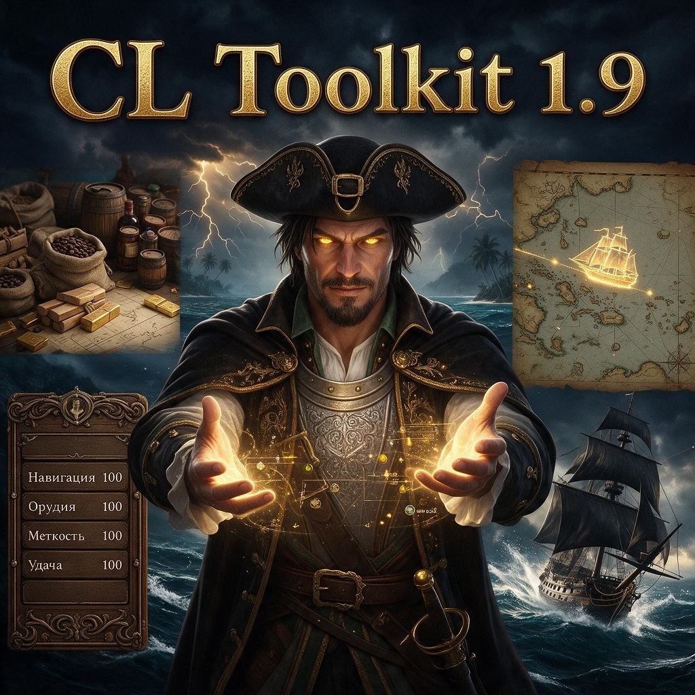

# CL Toolkit 1.9

> **Press INSERT to open the mod window. / Окно мода открывается клавишей INSERT.**

> **Ship coordinates at sea:** the normal sea (tactical) mode now shows ship coordinates, like the world map
> (same instruments: sextant / compass / chronometer; can be turned off in "Modes").
> **Координаты в море:** в обычном морском (тактическом) режиме теперь показываются координаты корабля, как на
> глобальной карте (по тем же приборам; отключается в «Режимах»).

**EN** — A cheat / sandbox toolkit for **Caribbean Legend 1.9.0** (Storm Engine). The game pauses while the
window is open. Interface language: Russian.
**RU** — Чит-тулкит / песочница для **Caribbean Legend 1.9.0**. Пока окно открыто, игра на паузе.
Язык интерфейса — русский.

"1.9" in the name is the game version the mod is made for. / «1.9» в названии — версия игры, а не мода.

## Features / Возможности

| EN | RU |
|---|---|
| Hub: hero card, money, quick actions (max PIRATES, heal, +500 ammo, repair), log | Хаб: карточка героя, деньги, быстрые действия (PIRATES на максимум, лечение, +500 боеприпасов, ремонт), журнал |
| Hero toggles: immortality, infinite energy, weapons always loaded, unlimited weight, cannons without reload, accurate broadsides, no ship-class penalty, no random encounters | Переключатели героя: бессмертие, бесконечная энергия, оружие всегда заряжено, вес без ограничений, пушки без перезарядки, супер-точность залпа, без штрафа за класс корабля, без случайных встреч |
| Character: any party member — max HP/energy, reputation, loyalty, hero rank | Персонаж: любой член отряда — макс. здоровье/энергия, репутации, лояльность, ранг героя |
| Skills: PIRATES, skills, free points, background perks | Умения: PIRATES, умения, свободные очки, перки предысторий |
| Items: all items by category, search, give any quantity | Предметы: все предметы по категориям, поиск, выдача |
| Ship: **class (rank)** for quest requirements, stats, hidden handling coefficients, crew, cannons, repair, specialization, trait | Корабль: **класс (ранг)** под требования квестов, характеристики, скрытые коэффициенты управления, команда, орудия, ремонт, специализация, свойство |
| Cargo: all 50 goods | Трюм: все 50 товаров |
| Modes: game cheat flags, damage multiplier, world-map speed, sea teleport ("Sail To" from any distance), atlas teleport (atlas M → right-click), port storage limit, leave battle keeping the fleet, Steam achievement unlock | Режимы: штатные чит-флаги, множитель урона, скорость на карте, морской телепорт («Доплыть» с любой дистанции), телепорт по атласу (атлас M → ПКМ), лимит стоянки в порту, выход из боя с флотом, открытие достижения Steam |
| World: relations, location, date/time, encounters, special fleets finder with map | Мир: отношения, где мы, дата/время, встречи, поиск особых флотов со схемой |
| Inspector: read-only attribute tree | Инспектор: дерево атрибутов (чтение) |
| Squadron up to 8 ships | Эскадра до 8 кораблей |

## Install / Установка

- **Steam Workshop** — subscribe. / Подписаться в Мастерской.
- **Manually / Вручную** — copy the `CLToolkit` folder into the game folder as `mod_cltoolkit` and add a line
  `mod_cltoolkit` to `overlays.txt` in the game folder; `engine.ini` must have `mod_safe_mode = 0`.
  / Скопировать папку `CLToolkit` в папку игры под именем `mod_cltoolkit` и добавить строку `mod_cltoolkit`
  в `overlays.txt` в папке игры; в `engine.ini` — `mod_safe_mode = 0`.

## Compatibility / Совместимость

- Game 1.9.0; can be added to an existing save. / Игра 1.9.0; можно ставить на текущий сейв.
- **Not compatible with "Navigator 1.9"** — CL Toolkit replaces it and keeps its saved toggles (`pchar.Navigator.*`).
  / **Несовместим с «Навигатором 1.9»** — заменяет его, сохранённые переключатели «Навигатора» работают.
- Overrides game files / Заменяет файлы игры:
  `Loc_ai\LAi_character.c`, `Loc_ai\fightparams\common.c`, `characters\RPG\weight.c`,
  `characters\RPG\perks\perks.c`, `characters\characters.h`, `sea_ai\AICannon.c`, `scripts\companions.c`,
  `battle_interface\BattleInterface.c`, `interface\mapview.c`. Mods replacing the same files are not compatible.
  / Моды, заменяющие те же файлы, несовместимы.
- Before removing the mod, reduce the squadron to 5 ships. / Перед удалением сократите эскадру до 5 кораблей.

## Repository / Репозиторий

| Path | What |
|---|---|
| `CLToolkit/` | mod overlay = Workshop contents folder (`Program`, `Resource`) / оверлей мода = папка для Мастерской |
| `poster.jpg` | Workshop preview / превью |
| `WORKSHOP.md` | Workshop fields and description / поля и описание публикации |
| `tools/` | dev tools: window layout generator `gen_clt_ini.py` (writes `clt_main.ini`), preflight `clt_check.py`; paths expect the mod at `<game>\mod_cltoolkit` / инструменты разработки, пути — под мод в `<игра>\mod_cltoolkit` |

## License / Лицензия

Distributed under the terms of the [Storm Engine EULA](https://github.com/Blackmark-Studio/Caribbean-Legend/blob/main/LICENSE.md).
/ Распространяется на условиях Storm Engine EULA. See [LICENSE.md](LICENSE.md).
